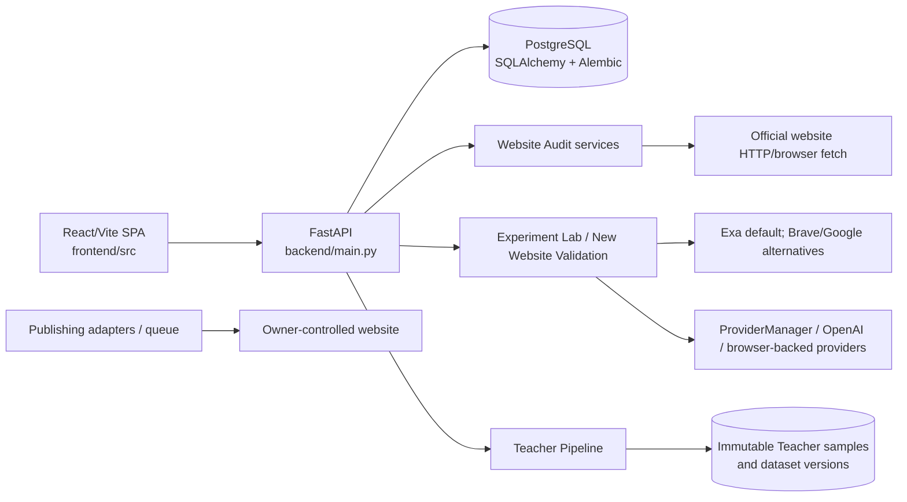

# GEO Engine integration handoff

Audit date: 2026-10-22
Scope: read-only review of the GEO Engine repository. No source code, database, deployment setting, or experiment was changed for this handoff.

## Executive summary

GEO Engine is a property-scoped React/Vite + FastAPI/SQLAlchemy/PostgreSQL application. It already has a credible audit → controlled experiment → evaluation → immutable Teacher dataset path. The strongest integration seam for the two independent repositories is the existing `Property` record and the existing `WebsiteAudit`/experiment identifiers. The Research Outreach Agent should deliver a versioned profile/cohort payload to a new import boundary (or an external adapter), while GeoAIResume remains the owner-controlled publication target. Neither repository is currently imported or called by this checkout, and there is no stable cross-repository contract in the code today.

The current platform can audit an official URL, preserve extracted page evidence, choose an audit-supported strategy, rewrite a selected target document in a controlled experiment, run repeated LLM answers, measure visibility/citation metrics, and write provenance-rich Teacher samples. It cannot yet ingest a company/hotel profile as a first-class external object, prove that a proposed change was deployed to the owner’s site, run a post-deployment comparison linked to a deployment commit, or export a native DOCX report. Provider-backed work also depends on environment credentials and, for browser-backed providers, local session state.

## 1. Current architecture

### Runtime topology



The API process initializes SQLAlchemy metadata in `backend/main.py` and calls `seed_default_property`; normal schema evolution is represented in `backend/alembic/versions/`. The application is property-centric: the frontend’s active property context sends `property_id` to API calls (`frontend/src/contexts/PropertyContext.tsx`, `frontend/src/api/client.ts`).

### Frontend pages and modules

`frontend/src/App.tsx` registers the SPA routes:

| Route/page | Current responsibility | Integration relevance |
|---|---|---|
| `/` (`Dashboard.tsx`) | Property-scoped dashboard and navigation | Entry point for imported profiles/properties |
| `/audit` (`WebsiteAudit.tsx`) | Run/view persisted Website Audits, evidence, coverage, recommendations | Official website evidence source |
| `/predictor` (`GeoPredictor.tsx`) | Audit opportunity and single-strategy selection; predictor remains a foundation/placeholder | Strategy review handoff |
| `/experiments` (`ExperimentLab.tsx`) | General experiments, Princeton replication controls and run status | Research execution and artifact inspection |
| `/teacher-pipeline` (`TeacherPipeline.tsx`) | Dataset/sample status, grouped Teacher experiments, JSONL/CSV links | Training-data handoff |
| `/citations` (`CitationTests.tsx`) | Provider comparison and citation/mention testing | Baseline/post-deployment observability |
| `/content` (`ContentGeneration.tsx`) | LLM content/FAQ generation and retrieval tasks | Proposed content artifacts |
| `/history` (`ContentHistory.tsx`) | Content/history events | Version trace, not deployment proof |
| `/publishing` (`PublishingQueue.tsx`) | Publishing jobs/tasks and publisher adapters | Proposed → submitted/published transition |
| `/settings` (`Settings.tsx`) | Provider/configuration visibility | Operational readiness |

Shared API helpers are in `frontend/src/api/`; the property selector is in `frontend/src/components/PropertySelector.tsx`. The frontend does not directly own an external company, hotel, or cohort identity.

### Backend API surface

Routes are registered in `backend/main.py` and grouped under `backend/app/api/v1/`:

- Properties: `property_routes.py` — `GET/POST /api/v1/properties`, `GET/PATCH /api/v1/properties/{property_id}`.
- Audit: `audit_routes.py` — `POST /api/v1/audit/run`, `GET /latest`, `GET /history`, `GET /{audit_id}`.
- Experiment Lab: `experiment_lab_routes.py` — general `/run`, `/experiments`, experiment polling/detail and JSON/CSV export; `/teacher-validation`; Princeton official replication and campaign endpoints.
- Teacher Pipeline: `backend/app/teacher_pipeline/router.py` — dataset-generation preview/start, `/status`, `/samples`, and `/dataset/export?format=jsonl|csv`.
- Predictor: `backend/app/predictor/router.py` — predictor foundation status/dataset/export/train/predict operations; this is not a production optimization model.
- Content/history: `content_routes.py`, `history_routes.py`, `optimization_routes.py`.
- Citation: `citation_routes.py` and `citation_test_routes.py`.
- Providers/accounts/publishing/query/benchmark/campaigns: corresponding route modules under `backend/app/api/v1/`.

There is no route for importing an Outreach Agent profile, receiving a deployment callback, or producing a DOCX artifact.

### Database schema groups

The ORM models in `backend/app/models/` and `backend/app/teacher_pipeline/models.py` expose these relevant groups (migration history is under `backend/alembic/versions/`):

| Group | Tables/models and important identifiers |
|---|---|
| Registration | `properties` (`Property.id`, unique `domain`, name/brand/description) |
| Audit | `website_audits` (`WebsiteAudit.id`, `property_id`, status, URL, coverage/extraction counters, nullable evidence-based scores); `website_pages` (`WebsitePage.id`, `audit_id`, URL, HTTP/browser extraction, hashes, headings, links, evidence JSON, GEO importance/selection provenance); `website_audit_recommendations` (`id`, `audit_id`, objective evidence, affected/evaluated counts, suggested strategy) |
| Experiments | `experiments`, `experiment_runs`, `experiment_queries`, `experiment_documents`, `experiment_strategy_results`, `experiment_evaluations`, `experiment_metrics`, `experiment_statistics`, `experiment_events`, prompt versions/campaigns/benchmarks |
| Teacher data | `teacher_training_samples` (immutable sample ID, `experiment_id`/run/query/audit/property FKs, feature vector, strategy, provider/model/prompt/evaluation/metric versions, original/optimized/delta JSON, provenance JSON/hash, dataset version); `teacher_dataset_versions`; `teacher_dataset_members` |
| Content and deployment | `contents`, `faq_sets`, `faqs`, history events, publishing jobs/tasks, retrieval tasks |
| Citation/research | Citation tests/runs/results, platform questions, accounts/sessions, benchmark and campaign records |

`TeacherTrainingSample` and dataset version/member records are protected against update/delete by model events (`backend/app/teacher_pipeline/models.py`). This is a good scientific boundary, but it is not a deployment ledger.

## 2. Existing end-to-end capabilities

### Website/project registration

`PropertyCreateRequest` in `backend/app/api/v1/property_routes.py` accepts `name`, `domain`, optional brand and description. `property_service.py` normalizes schemes for stored user-created domains, seeds the configured `DEMO_TARGET_URL` as the GeoAIResume property, and retains a legacy-domain migration path. There is no profile type (`company` versus `hotel`), external source ID, owner organization, or cohort ID. A Research Outreach profile therefore must currently be flattened into property name/domain/description, losing source identity unless an integration layer preserves it externally.

Existing GeoAIResume/demo assets are tracked in `backend/app/experiment/data/geoairesume_reference_pack.json`, `geoairesume_target_snapshot.json`, and `backend/app/experiment/demo_reference_pack.py`. The matcher requires the stable demo name and canonicalized target domain. These are demo fixtures, not a general profile-import mechanism.

### Audit and exact evidence

`backend/app/services/website_audit/crawler.py` performs sitemap/robots-aware discovery with configurable limits (`WEBSITE_AUDIT_MAX_PAGES`, candidate/sample limits), while `extractor.py` and rendering/browser-fallback modules produce structured evidence. `audit_service.py` orchestrates persistence through `repository.py` and recommendations. Page records retain requested/final/canonical URL, extraction method/failure, body/word counts, hashes, heading/link/schema/authorship evidence, and GEO importance/selection signals. The audit is therefore suitable as an evidence snapshot, subject to crawl caps, robots/provider availability, and browser fallback limits.

The audit is not a complete legal or business profile: a successful HTTP response is not automatically a usable evidence page, duplicate/fallback content is excluded from unique scientific evidence, and scores/opportunities can be unavailable when evidence is insufficient. The integration should preserve the audit ID and page IDs, not copy page text into an external profile record.

### Strategy generation/ranking

Objective recommendations are generated in `backend/app/services/website_audit/recommendations.py` from observed evidence and persisted with affected-page counts/evidence. `suggested_strategy` and priority provide a recommendation. The supported Princeton-style treatment IDs are implemented in `backend/app/ge/geo_rewriter.py`/`prompt_builder.py` (including `faq`, `statistics`, `citation`, `quotation`, `authoritative`, `easy_to_understand`, `fluency`, `unique_words`, `technical_terms`, and `keyword_stuffing`; `original` is baseline). There is no learned strategy ranker. “Top three strategies” can currently be derived as the three highest-priority evidence recommendations, but that is a rule-based selection and must be labeled as such; it is not a validated model ranking.

### Rewriting and experiment workflow

`backend/app/api/v1/experiment_lab_routes.py` delegates teacher validation to `app/experiment/new_website_validation.py`, then `ExperimentService` and the existing GE execution path. `AuditQueryContextGenerator`/`TrainingContextBuilder` in `backend/app/teacher_pipeline/` create a deterministic versioned query from audit evidence, retrieve four references, freeze target + references, and record query policy, retrieval provider/timestamp, target index, content hashes, and source ordering. `GeoRewriter.rewrite_artifact()` applies the selected strategy only to the target document; baseline and treatment retain the same query, sources, generation configuration, and evaluation configuration. This is the correct controlled-intervention seam for an imported official page.

### LLM evaluation and citations

`backend/app/evaluation/evaluator.py`, `experiment_pipeline.py`, and subjective-evaluation modules calculate visibility/PAWC, citation, position and related metrics from repeated answers. `citation_test_service.py` plus citation models/routes run provider comparisons and persist response text, extracted citations, mention/rank/visibility and status. These are usable for baseline and post-deployment evaluation, but the citation test is not automatically linked to a deployment or Outreach cohort.

### Questions

The Teacher path has `AuditQueryContextGenerator` (`backend/app/teacher_pipeline/query_contexts.py`) which generates small, deterministic, versioned evaluation-query contexts from property/audit/page evidence and query policy. `platform_question.py`, `query.py`, FAQ discovery, and content query routes serve other product workflows. There is no import endpoint for realistic customer-discovery questions from the Research Outreach Agent, no question-source foreign key, and no explicit human-curated question approval state.

### Content history and versioning

Content generation (`content_routes.py`/`content_service.py`), history repositories/services, and publishing jobs preserve generated content and history events. Experiment records preserve run/query/document/result rows and generation parameters. Teacher samples preserve immutable provenance and dataset versions. Missing is a unified content artifact version that links: imported profile → audit page snapshot → recommendation → proposed rewrite → owner-approved deployment commit/URL → post-deployment audit/evaluation.

### Exports

Experiment Lab provides experiment JSON/CSV exports and official replication artifacts. Teacher Pipeline provides JSONL/CSV dataset exports. Content/publishing APIs expose operational records. No native DOCX report generator or stable report schema exists. DOCX generation should be an external reporting adapter over versioned API exports, not a duplicate experiment implementation.

## 3. Providers, credentials, and authentication

`backend/app/core/config.py` reads environment settings. Required runtime settings include `OPENAI_API_KEY` and `DATABASE_URL`; optional retrieval settings include `EXA_API_KEY`, `BRAVE_SEARCH_API_KEY`, `GOOGLE_SEARCH_API_KEY`, and `GOOGLE_SEARCH_ENGINE_ID`. `SEARCH_PROVIDER` defaults to `exa`; `search_provider_factory.py` selects Exa, Brave, or Google and fails clearly when required credentials are absent. Provider status is exposed through `provider_routes.py`. No secret values were read or copied during this audit.

LLM execution is mediated by `backend/app/providers/provider_manager.py`: ChatGPT/OpenAI is active; Perplexity uses a local browser session; Claude/Gemini are registered stubs and are not executable. Website crawling may use plain HTTP and optionally browser fallback; browser-backed retrieval/publishing requires local session state and is not a portable cloud integration.

The current API uses FastAPI dependency injection for database sessions (`backend/app/core/deps.py`). The inspected business routes accept `property_id` but do not show a tenant/user authentication dependency or bearer-token contract. Account/session routes manage publishing accounts, not API authorization. For production integration, an authenticated gateway and tenant ownership checks are required before accepting third-party profile imports or deployment callbacks.

## 4. Integration readiness matrix

| Requested capability | Status today | Existing seam | Constraint / handoff decision |
|---|---|---|---|
| Import company/hotel profile | Missing as first-class feature | `POST /api/v1/properties`; `Property` | Add an adapter/import contract preserving source profile ID/type/version; do not overload `description` |
| Audit official website | Working | `POST /api/v1/audit/run` and audit services | Requires public URL, crawl capacity, and valid HTML/browser fallback |
| Exact page text/source evidence | Working/partial | `website_pages.evidence_json`, hashes, page IDs | Snapshot retention and access policy should be explicit for external profile provenance |
| Rank top three GEO strategies | Partial | evidence recommendations + priority/suggested strategy | Rule-based only; no learned ranker or calibrated top-three confidence |
| Sentence-level recommendations | Partial | recommendation evidence and content/rewriter artifacts | No stable sentence-anchor recommendation API across audit → content → deployment |
| Realistic customer discovery questions | Partial | deterministic Teacher query contexts; platform questions | Outreach Agent question source/import and approval metadata absent |
| Baseline LLM evaluations | Working/credentialed | Experiment Lab, `ExperimentService`, evaluator | Requires OpenAI/selected provider; repeated calls cost money |
| Mentions/order/citations | Working/partial | Citation tests and experiment metrics | Provider-specific outputs; no unified cohort/post-deploy comparison key |
| Proposed vs deployed changes | Partial | content/history + publishing queue | No deployment receipt/commit/version/remote URL verification contract |
| Post-deployment evaluations | Partial | rerun audit, citation tests, experiments | No first-class “before/after deployment” relation or automatic trigger |
| DOCX structured export | Missing | JSON/CSV/JSONL exports | Add report adapter outside scientific core; do not duplicate DB logic |
| Outreach company/hotel/cohort linkage | Missing | none | Require external stable IDs and import manifest |
| GeoAIResume owner publication | Partial | static/WordPress publisher adapters and publishing jobs | Owner-controlled repository/deployment API is not integrated or authenticated here |

## 5. Proposed integration contract

The following is a handoff design, not an implementation. It reuses existing IDs and adds an adapter boundary rather than duplicating audit, experiment, or Teacher modules.

### Stable identities

| Identifier | Owner | Format and rule |
|---|---|---|
| `source_profile_id` | GEO Research Outreach Agent | Opaque stable string; never derive from name/domain |
| `source_profile_version` | Outreach Agent | Immutable version/revision string or content hash |
| `cohort_id` | Outreach Agent | Opaque stable cohort ID; optional for one-off imports |
| `property_id` | GEO Engine | Existing integer `properties.id`; one current official domain per property |
| `audit_id` | GEO Engine | Existing `website_audits.id`; immutable evidence snapshot reference |
| `page_id` | GEO Engine | Existing `website_pages.id`; exact page/evidence reference |
| `recommendation_id` | GEO Engine | Existing `website_audit_recommendations.id` |
| `experiment_id` / `experiment_run_id` | GEO Engine | Existing experiment/run identifiers |
| `sample_id` / `dataset_version` | GEO Engine | Existing immutable Teacher identifiers |
| `deployment_id` | Owner/GeoAIResume integration | New external receipt ID; must not be simulated by a publishing job ID |

### Profile import payload

```json
{
  "source_system": "geo-research-outreach-agent",
  "source_profile_id": "company-or-hotel-opaque-id",
  "source_profile_version": "profile-revision-or-sha256",
  "cohort_id": "optional-cohort-id",
  "entity_type": "company|hotel",
  "official_name": "string",
  "official_domain": "https://example.org",
  "official_urls": ["https://example.org/about"],
  "profile_snapshot": {},
  "contact_evidence_refs": [],
  "customer_questions": [
    {"question_id": "outreach-q-1", "text": "...", "source": "interview|research|generated", "approved": false}
  ],
  "received_at": "RFC-3339 timestamp"
}
```

The adapter should idempotently map `source_profile_id` + version to a property/import record, retain the complete payload outside the existing `Property` columns, and then call the existing audit endpoint with the official URL. Contact evidence must not be sent to LLM prompts unless explicitly approved and redacted according to policy.

### Read/execute API contract

Recommended future endpoints (names are proposed; they do not exist today):

- `POST /api/v1/integrations/outreach/profiles` — authenticated, idempotent profile import; returns `source_profile_id`, `property_id`, `source_profile_version`.
- `GET /api/v1/integrations/outreach/profiles/{source_profile_id}` — import status and linked property/audit IDs.
- Existing `POST /api/v1/audit/run` with `property_id`; return `audit_id`, coverage, pages, and evidence hashes.
- Existing audit read endpoints for `audit_id` and page evidence.
- A future strategy-ranking read endpoint should return recommendation IDs, evidence, priority, and rank policy version—not just labels.
- Existing `POST /api/v1/experiment-lab/teacher-validation` with `property_id`, `audit_id`, `opportunity_id`, `strategy`, provider/model, seed, and temperature.
- Existing `GET /api/v1/experiment-lab/runs/{experiment_id}` for status and result.
- Existing Teacher `/status`, `/samples`, and dataset export endpoints.
- Future `POST /api/v1/integrations/deployments` receipt callback from GeoAIResume: `deployment_id`, property/source IDs, repository commit or deployment URL, changed artifact IDs, deployed timestamp, and verification status.
- Future post-deployment evaluation endpoint should accept `deployment_id` plus an existing audit/experiment plan and create a new immutable run; it must never overwrite baseline evidence.

All integration endpoints should require a service-to-service bearer token or signed webhook, enforce tenant/source ownership, support an idempotency key, and return correlation IDs. The current routes do not provide this contract.

### Experiment state machine

Use explicit states across the adapter and existing experiment records:

```text
IMPORTED
  → AUDIT_QUEUED → AUDIT_RUNNING → AUDIT_COMPLETED
  → STRATEGIES_READY → APPROVAL_REQUIRED → EXPERIMENT_QUEUED
  → BASELINE_RUNNING → TREATMENT_RUNNING → EVALUATING
  → TEACHER_SAMPLE_READY → DATASET_VERSIONED
  → PROPOSED → OWNER_APPROVED → DEPLOYMENT_REQUESTED
  → DEPLOYED_VERIFIED → POST_DEPLOYMENT_EVALUATING → COMPLETE
```

Terminal/error states should be `AUDIT_FAILED`, `INSUFFICIENT_EVIDENCE`, `EXPERIMENT_FAILED`, `DEPLOYMENT_FAILED`, and `POST_DEPLOYMENT_FAILED`. Existing `Experiment.status` values and audit statuses can be mapped into this envelope, but the cross-repository state and transition history do not currently exist.

### Proposed-vs-deployed artifact schema

The adapter should reference existing artifacts rather than copy them:

```json
{
  "property_id": 123,
  "source_profile_id": "outreach-id",
  "audit_id": 456,
  "page_id": 789,
  "recommendation_id": 12,
  "experiment_id": 34,
  "strategy": "citation",
  "proposed_artifact": {
    "content_version": "sha256",
    "source_page_id": 789,
    "rewrite_plan_version": "rewrite-plan-v1",
    "approval_status": "pending|approved|rejected"
  },
  "deployment": {
    "deployment_id": null,
    "repository": "owner-controlled-repo",
    "commit_sha": null,
    "public_url": "https://example.org/page",
    "verified_at": null,
    "status": "not_deployed|requested|verified|failed"
  }
}
```

## 6. Human approval and safety gates

Human approval is required before: accepting third-party profile/contact data into a tenant; selecting a business-sensitive strategy; using contact evidence in prompts; publishing a rewrite to GeoAIResume; marking a deployment verified; and exporting a report containing private contact evidence. API credentials are required before live Exa/Brave/Google retrieval or OpenAI/other LLM calls. A clean audit and deterministic evidence extraction do not require an LLM, but Teacher validation and citation tests do.

The current Teacher pipeline is designed for research dataset generation, not autonomous publication. Keep the frozen source set, target index, prompt/evaluation versions, content hashes, and raw answers immutable. Never treat a generated recommendation or Teacher metric delta as proof that an owner approved or deployed a change.

## 7. Recommended changes, in dependency order

1. Add a small integration adapter and persistent import manifest keyed by `source_profile_id`/version/cohort; leave `Property`, audit, and experiment modules unchanged.
2. Add tenant/service authentication and ownership checks to all integration and deployment callbacks.
3. Add a first-class “profile snapshot” and “question provenance” record, retaining raw source references and approval status without placing private contact evidence in `Property.description`.
4. Expose a read-only strategy-ranking response backed by existing recommendation evidence and an explicit policy version; do not call it ML ranking until validated.
5. Add a proposed-artifact/deployment receipt ledger that references existing content/history/publishing/experiment IDs and owner repository commit/deployment URL.
6. Add a post-deployment evaluation relation that creates new audits/citation/Teacher runs and compares them to immutable pre-deployment IDs.
7. Add a separate DOCX report adapter consuming the stable read APIs and embedding evidence citations, hashes, experiment states, and deployment status.
8. Add contract tests with mocked external repository payloads and idempotency/replay tests. Keep expensive LLM execution out of CI; use provider fixtures for transport tests.

## 8. Handoff checklist

- [x] Existing property, audit, experiment, citation, content-history, publishing, and Teacher seams identified.
- [x] GeoAIResume demo fixtures and matching path identified.
- [x] Provider names and required credential variables documented without exposing secrets.
- [x] Existing immutable sample/dataset and source-evidence identifiers documented.
- [ ] Outreach Agent profile/cohort import contract implemented.
- [ ] Service authentication and tenant ownership implemented for cross-repository calls.
- [ ] Owner deployment receipt and commit verification implemented.
- [ ] Post-deployment evaluation relation implemented.
- [ ] Native DOCX report adapter implemented.

## Conclusion

Use `Property → WebsiteAudit → WebsitePage → Recommendation → Experiment/Run → TeacherTrainingSample → TeacherDatasetVersion` as the canonical GEO Engine chain. The external systems should attach their own stable IDs and snapshots to that chain through an authenticated adapter. This preserves existing scientific methodology and avoids duplicating the crawler, strategy engine, evaluator, or Teacher Pipeline while making proposed content, owner approval, actual deployment, and post-deployment evidence distinguishable.
